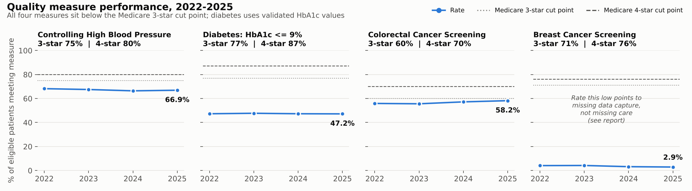
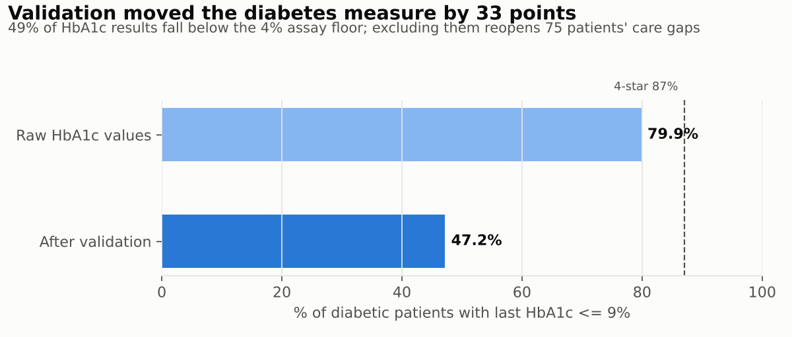
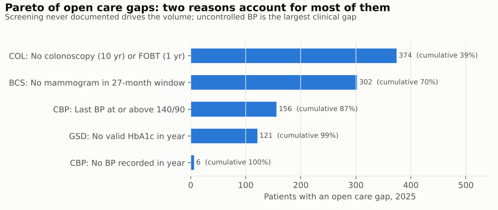
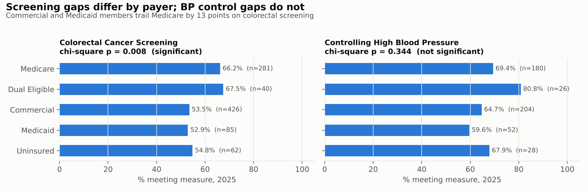
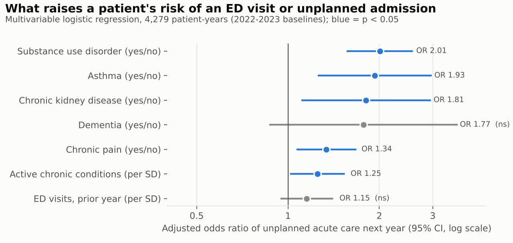
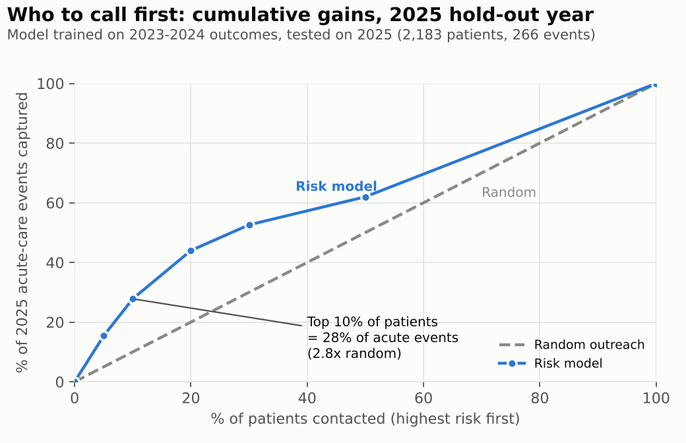
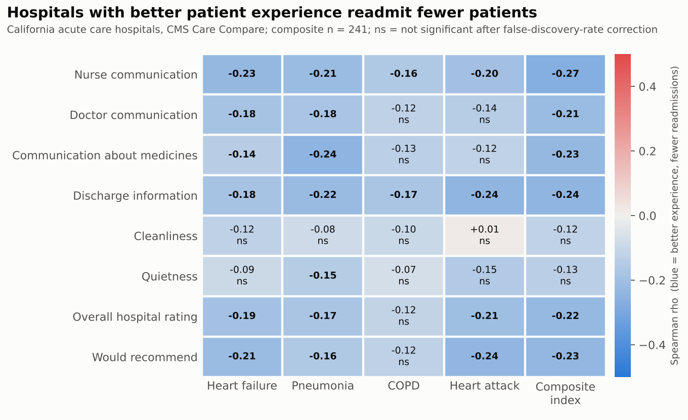
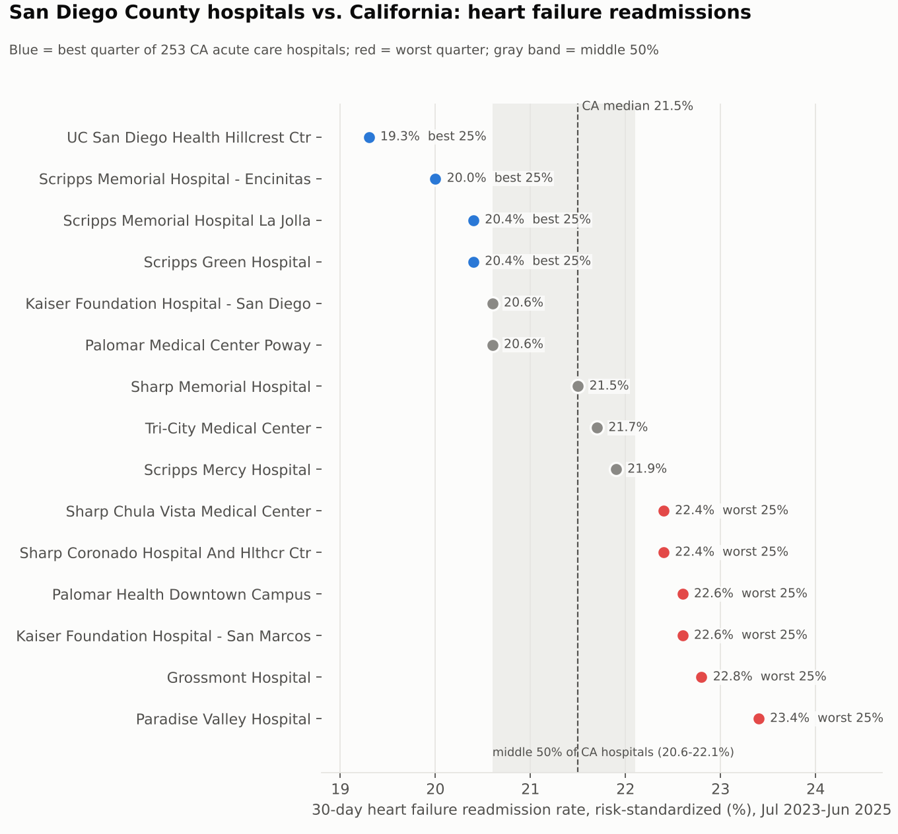

# Healthcare Quality Analytics: EHR Data Mining, Validation, Quality Measures, Risk Prediction and Hospital Benchmarking

An end-to-end clinical quality analytics project built on **publicly available, non-proprietary data**.
It mines a synthetic EHR, validates it, calculates HEDIS-style quality measures against Medicare Star
Ratings benchmarks, tests for disparities, predicts which patients are likely to need unplanned acute
care, benchmarks 276 real California hospitals on readmissions and patient experience using public
CMS data, and closes with recommendations and a monitoring plan.

**Author:** Damilare Shonuyi, MS Business Analytics candidate, UC San Diego Rady School of Management
**Tools:** SQL (DuckDB), Python (Polars, scikit-learn, XGBoost, statsmodels, SciPy), matplotlib

> **Data:** All patient records are synthetic, generated with [Synthea](https://github.com/synthetichealth/synthea),
> an open-source simulator of realistic EHR data. No real patient information is used. Hospital
> benchmarking uses real, public, hospital-level data from [CMS Care Compare](https://data.cms.gov/provider-data/topics/hospitals).
> Measure benchmarks come from public CMS Star Ratings cut points.

---

## Key findings

| | Finding |
|---|---|
| **Data validation** | 49% of HbA1c results fall below the 4% assay floor. Using raw values, diabetes control reads **79.9%**. After validation it reads **47.2%**. Data quality alone moved the measure by 33 points. |
| **Quality measures** | Blood pressure control **66.9%**, colorectal screening **58.2%**. Both are below the Medicare 3-star cut points (75% and 60%) and flat over four years. |
| **Data capture** | Breast cancer screening at 2.9% signals missing data (mammograms done outside the system), not missing care. Supplemental data comes before outreach. |
| **Equity** | Colorectal screening differs significantly by payer (chi-square p = 0.008). Commercial and Medicaid members trail Medicare by 13 points. |
| **Prediction** | A logistic model identifies a top 10% of patients who account for **28% of next year's acute-care events** (2.8x random, AUC 0.65 on a held-out year). Substance use disorder doubles the odds. |
| **Hospital benchmarking (real CMS data)** | Across 241 California hospitals, better patient experience goes with fewer readmissions (nurse communication rho = -0.27, discharge information rho = -0.24; both significant after multiple-testing correction). 6 of 15 San Diego County hospitals fall in the state's worst quarter for heart failure readmissions. |

Full write-up: **[Findings and Recommendations](reports/findings_and_recommendations.md)**



---

## What this project covers

| Skill | Where it lives |
|---|---|
| **Mining EHR data** | `sql/` - SQL across patients, encounters, conditions, observations, procedures, medications and payer tables. Builds measure denominators, numerators, exclusions and features |
| **Data validation** | `src/02_validate.py` - 25 rules across 5 data-quality dimensions, with severity and a recommended action for each. `tests/` plants known errors and confirms the rules catch them |
| **Data analysis** | `src/03_quality_measures.py` - 4 quality measures, 4-year trends, stratification by payer, race/ethnicity, income and sex, with chi-square tests, a care-gap Pareto and a patient outreach list |
| **Correlation and prediction** | `src/04_risk_model.py` - point-biserial and Spearman correlations, multivariable odds ratios with 95% CIs, logistic regression vs XGBoost with temporal validation, lift and calibration |
| **Hospital benchmarking** | `src/06_cms_hospital_analysis.py` - joins three CMS Care Compare files, builds a readmission index, runs Spearman correlations with false-discovery-rate correction, a robust multivariable regression and a Kruskal-Wallis ownership test |
| **Visualization** | `figures/` - trend, validation impact, disparity, Pareto, odds-ratio, gains, correlation heatmap, scatter and hospital benchmark charts |
| **Healthcare operations** | Measure logic modeled on HEDIS and Medicare Star Ratings, the Hospital Readmissions Reduction Program (HRRP) conditions, HCAHPS, planned vs unplanned admission logic, hospice exclusions, payer product lines and supplemental-data reasoning |

---

## 1. Data validation

Before any measure is calculated, every record passes a rule-based audit
([full report](reports/data_quality_report.md)).

| Dimension | Example rules |
|---|---|
| Uniqueness | Duplicate patient or encounter IDs |
| Referential integrity | Visits for patients who don't exist; labs tied to no visit; encounters with no payer |
| Temporal validity | Discharge before admission; clinical visits after death; records dated after the extract |
| Clinical plausibility | BP outside physiologic range; diastolic >= systolic; HbA1c outside the 4-18% reportable range; mixed units |
| Completeness | Missing race/ethnicity (needed for equity stratification), sex, birth date, ZIP code or provider |



Two findings show why validation needs judgment, not just rules:
- **360 encounters after death** turned out to be administrative "Death Certification" visits. They were
  reclassified as expected behavior rather than flagged as errors.
- **Half of all HbA1c results are implausibly low.** That is a systemic interface problem, not a batch of
  typos. The right call is to hold the measure and escalate, not quietly drop half the data.

## 2. Quality measures

Four HEDIS-style measures, approximated from public definitions because the official NCQA specifications
are licensed. Simplifications are documented in [docs/measure_definitions.md](docs/measure_definitions.md).

| Measure | 2025 | Eligible | 3-star | 4-star |
|---|---:|---:|---:|---:|
| Controlling High Blood Pressure | 66.9% | 490 | 75% | 80% |
| Diabetes: HbA1c <= 9% (validated) | 47.2% | 229 | 77% | 87% |
| Colorectal Cancer Screening | 58.2% | 894 | 60% | 70% |
| Breast Cancer Screening | 2.9% | 311 | 71% | 76% |





## 3. Predicting unplanned acute care

**Outcome:** any ED visit or unplanned hospital stay in the following year. Planned care is excluded:
chemotherapy cycles, rehab and detox, transplant, elective orthopedic and obstetric admissions.

**Validation:** trained on 2022-2023 baselines, tested on the 2025 outcome year, which the model never saw.
This mirrors how the model would run in production.

| Model | AUC | PR-AUC | Top-10% capture |
|---|---:|---:|---:|
| Rule: prior-year acute visits | 0.556 | 0.175 | 18% |
| **Logistic regression (selected)** | **0.647** | **0.263** | **28%** |
| XGBoost | 0.654 | 0.256 | 28% |

Logistic regression was kept because XGBoost added only 0.007 AUC, and clinicians need to see why a
patient was flagged.





> **Why not 30-day readmissions?** That was the original target. After planned oncology cycles were
> excluded, the synthetic cohort had only 13 readmissions in 366 index stays, too few to model without
> overfitting. Acute-care use (768 events) serves the same population-health purpose with enough data.

## 4. Hospital benchmarking with real CMS data

**Data:** CMS Care Compare hospital files (public), filtered to California's 276 short-term acute care
hospitals. Readmission rates are risk-standardized 30-day rates for the HRRP conditions (heart failure,
pneumonia, COPD, heart attack; July 2023-June 2025). Patient experience comes from HCAHPS survey
linear mean scores. A composite **readmission index** averages each hospital's z-scores for heart failure,
pneumonia and COPD, so hospitals are compared on the same three conditions.

> CMS's newer Hybrid Hospital-Wide Readmission measure is listed in this release, but no hospital has a
> published score yet, so the analysis uses the condition-specific rates.



**What the data shows**
- **Patient experience tracks readmissions.** Six of eight HCAHPS dimensions correlate with a lower
  readmission index (rho -0.21 to -0.27) after false-discovery-rate correction. Nurse communication,
  discharge information and medication communication are the strongest. Cleanliness and quietness are not
  significant. The care-transition questions matter; the hotel-style questions don't.
- **The overall star rating reflects both.** The star rating correlates with the readmission index
  (rho = -0.42) and with patient experience (up to rho = +0.55 for "would recommend"). Median heart failure
  readmission is 20.4% at 5-star hospitals vs 21.8% at 1-star hospitals.
- **The effect is not independent.** In a multivariable regression, discharge information and the overall
  hospital rating are no longer individually significant once entered together (they are highly correlated).
  Larger heart failure volume goes with *higher* readmission (p = 0.001). The honest conclusion is that good
  experience scores and low readmissions are both signs of a well-run hospital. The data doesn't show that
  improving survey scores alone would cut readmissions.
- **Ownership:** heart failure readmission differs by ownership type (Kruskal-Wallis p = 0.001), but the
  practical gap is small (non-profit median 21.3% vs for-profit 21.8%). The larger difference is in star
  ratings (non-profit mean 3.4 vs for-profit 2.4).



**San Diego County:** UC San Diego Health Hillcrest (19.3%) and three Scripps hospitals sit in the state's
best quarter for heart failure readmissions. Six hospitals sit in the worst quarter, including Paradise
Valley (23.4%) and Grossmont (22.8%). That is a 4-point spread within one county, and it shows where a
regional transitions-of-care collaborative would have the most room to improve.

## 5. Recommendations (summary)

1. **Hold and fix the HbA1c feed** before reporting the diabetes measure; escalate to the lab interface team.
2. **Add supplemental mammography data** (claims or imaging centers) before launching outreach.
3. **Target colorectal screening outreach** (e.g., mailed FIT kits) at under-65 Commercial and Medicaid members.
4. **Run a BP-control huddle** for the 156 uncontrolled patients: repeat elevated readings, book follow-ups within 30 days, review medications.
5. **Pilot care management for the top 10% risk tier**, prioritizing patients with substance use disorder.
6. **Schedule the validation rules on every refresh** and trend them as a data-quality scorecard.
7. **Focus readmission work on care transitions,** not survey scores: discharge teaching, medication reconciliation and nurse communication are the HCAHPS areas that track readmissions. Use HCAHPS discharge scores as an early warning alongside the readmission rate, which is published with a long lag.

Owners, success metrics and the monitoring plan are in the [full report](reports/findings_and_recommendations.md#6-recommendations).

---

## Repository layout

```
├── run_all.py                       # runs the whole pipeline + tests
├── scripts/generate_synthea.sh      # regenerates the synthetic EHR (data/raw/)
├── sql/
│   ├── 00_typed_views.sql           # typed views over the raw extract
│   ├── 02_quality_measures.sql      # CBP, GSD, BCS, COL as parameterized table macros
│   └── 03_risk_features.sql         # patient-year feature set + outcome
├── src/
│   ├── 01_load_ehr.py               # CSV -> DuckDB warehouse
│   ├── 02_validate.py               # 25-rule data quality audit
│   ├── 03_quality_measures.py       # rates, trends, stratification, care gaps
│   ├── 04_risk_model.py             # correlations, odds ratios, models, lift, calibration
│   ├── 05_figures.py
│   └── 06_cms_hospital_analysis.py  # real CMS hospital benchmarking
├── tests/test_validation.py         # fault-injection test for validation rules
├── data/processed/                  # analysis outputs (CSV/Parquet, dashboard-ready)
├── figures/
├── reports/
│   ├── data_quality_report.md
│   └── findings_and_recommendations.md
└── docs/measure_definitions.md
```

## Reproduce

```bash
pip install -r requirements.txt
bash scripts/generate_synthea.sh      # requires Java 17+; ~2 GB of CSVs
# Download the three CMS files listed in data/cms/README.md into data/cms/
python run_all.py
```

The Synthea seeds are fixed (`-s 42 -cs 42`), so the same population is generated each time.

## Limitations

- Synthetic data reproduces realistic clinical patterns but not every real-world messiness. The
  validation rules are written for production data, and the fault-injection test exercises them.
- Measures approximate HEDIS logic. They are not certified and are not risk adjusted.
- Star Ratings cut points apply to Medicare Advantage contracts. Here they serve as external reference
  points for an all-payer population.
- The risk model uses EHR data only. Social-needs data would likely improve discrimination.
- The CMS analysis is cross-sectional and hospital-level. It shows association, not cause, and it can't
  be read as patient-level relationships (ecological fallacy).
